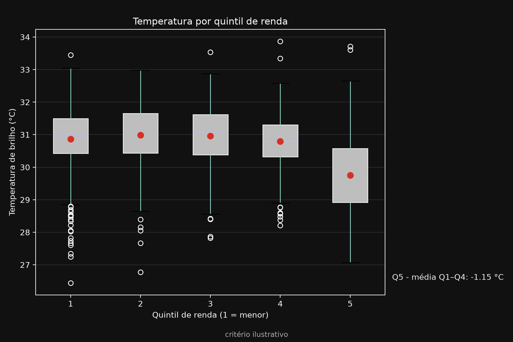
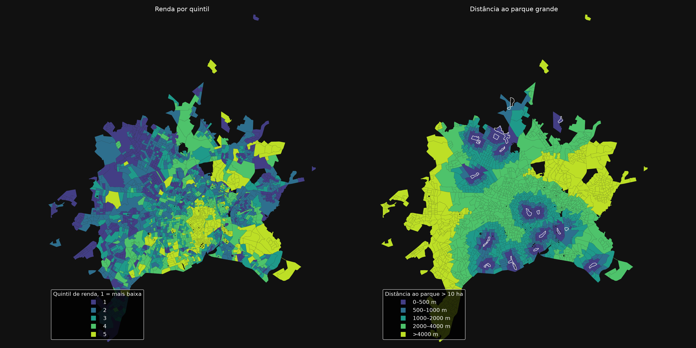
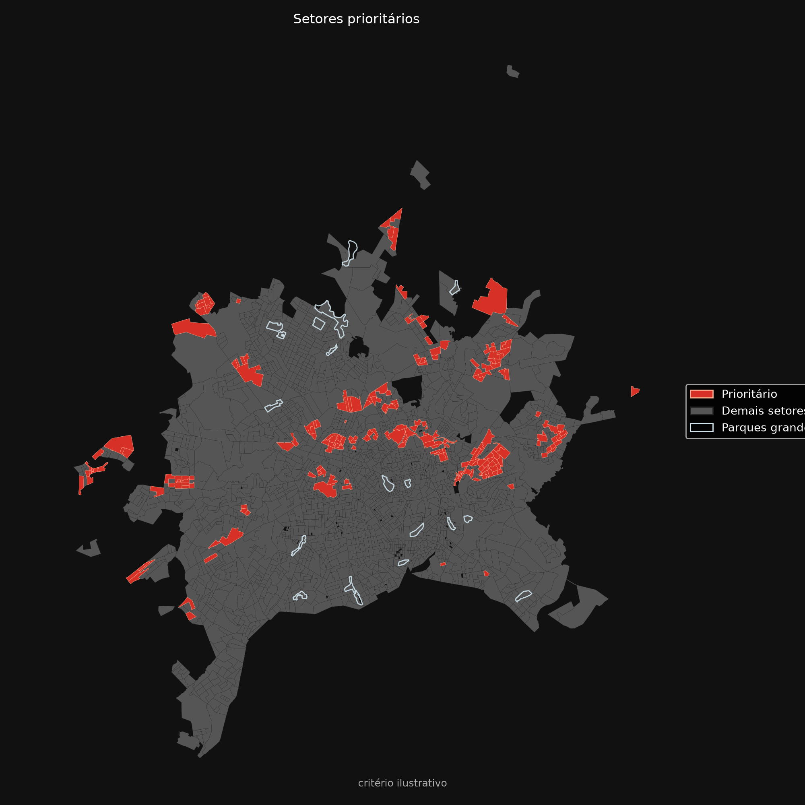

::: {.lede}
Goiânia é conhecida como cidade verde. Mas o frescor e o verde chegam a todos os bairros do mesmo jeito?

Para responder, cruzamos imagens de satélite com o Censo 2022 em **2.226 setores urbanos**. O resultado, em três pontos:
:::

1. **Só o grupo mais rico vive em um bairro mais fresco**, cerca de **1,15 °C** abaixo dos outros quatro grupos de renda, que são muito parecidos entre si.
2. **O acesso a parques grandes é desigual:** em média, 0,9 km para os mais ricos e 3,1 km para os mais pobres.
3. **225 setores** reúnem renda baixa, calor alto e distância de qualquer parque grande: são os candidatos a receber ação primeiro.

{.column-page}

## Por que olhar para o calor?

Calor urbano não se distribui por acaso. Superfícies construídas e solo exposto esquentam mais do que áreas com árvores e água, e o efeito se acumula em quem vive e trabalha nessas áreas. Em uma cidade grande, isso é uma questão de **justiça ambiental**: quem sofre mais com o calor é, muitas vezes, quem tem menos recursos para se proteger dele.

<!-- Se confirmar os trechos: acrescentar aqui a referência a Sousa e Ferreira (2012) sobre bairros periféricos e a ilha de calor em Goiânia. Só cite o que o texto realmente afirma. -->

A pergunta do trabalho é simples: **na Goiânia de hoje, o frescor está igualmente disponível?** Não buscamos provar que a renda *causa* o calor. Buscamos medir se existe uma desigualdade de exposição, e onde ela é mais forte.

## Os dados

| O que | De onde | Como entrou |
|---|---|---|
| Temperatura da superfície | Satélites Landsat 8 e 9 (banda térmica), ago–set 2026 | Média por setor |
| Renda | Censo 2022, IBGE (renda do responsável pelo domicílio) | Mediana por setor |
| Cobertura do solo | ESA WorldCover 2021 | % de árvores, construído, grama e solo exposto |
| Altitude | SRTM | Média por setor |
| Parques | OpenStreetMap, áreas acima de 10 ha (19 parques) | Distância do centro do setor ao parque mais próximo |
| Unidade de análise | Setores censitários urbanos (IBGE) | 2.226 setores após aplicar a máscara urbana |

::: {.column-margin}
**Setor censitário:** a menor área para a qual o IBGE divulga dados de renda. Em Goiânia, cada setor tem em geral algumas centenas de domicílios.
:::

::: {.callout-note collapse="true"}
## Como o satélite mede a temperatura
Usamos a **temperatura de brilho** da banda térmica do Landsat: a temperatura da *superfície* (telhado, asfalto, solo, copa de árvore), e não do ar que respiramos. Ela é útil para comparar áreas da mesma cidade, mas não equivale ao termômetro do dia a dia. Tentamos primeiro o produto de temperatura de superfície corrigido (nível 2), mas ele falhou em 513 setores, então usamos o produto de nível 1, que cobre todos. A janela é de agosto e setembro de 2026, no período seco do Cerrado.
:::

## O que fizemos, passo a passo

1. **Recortamos a área urbana.** Aplicamos uma máscara para tirar zonas rurais e vazios que distorcem a média de um setor.
2. **Calculamos a temperatura média de cada setor** a partir das imagens de satélite.
3. **Juntamos renda, cobertura do solo, altitude e distância a parques** na mesma tabela, uma linha por setor.
4. **Dividimos os setores em cinco grupos de renda (quintis)**, do mais pobre (Q1) ao mais rico (Q5).
5. **Comparamos a temperatura entre os grupos** e testamos se a diferença se mantém depois de controlar por vegetação, área construída, altitude e parques.
6. **Marcamos os setores prioritários** com um critério explícito e testamos a sensibilidade a ele.

## Só os mais ricos têm um bairro mais fresco

::: {.pull}
Entre cinco grupos de renda, só o mais rico escapa do calor.
:::

Os grupos Q1 a Q4 têm temperatura muito parecida: a mediana de cada um fica em torno de 31 °C. Só o Q5 se separa, cerca de 1,15 °C abaixo da média dos outros quatro.

::: {.column-margin}
**Como ler o gráfico:** cada caixa é um grupo de renda. A linha dentro é a mediana, a caixa cobre a metade central dos setores, e os pontos soltos são setores muito diferentes da média do grupo.
:::

Isso quer dizer que **não existe uma escada** em que cada aumento de renda traz um pouco de frescor. A vantagem está concentrada no topo.

::: {.callout-note collapse="true"}
## Detalhe técnico: quintis
Os quintis são relativos: dividem os setores em cinco grupos de tamanho parecido pela renda mediana. Como muitos setores têm a mesma renda, os grupos não ficam exatamente iguais. A correlação de Spearman entre renda e temperatura é de cerca de −0,31, uma associação moderada.
:::

## Não é só falta de árvore

::: {.pull}
A explicação mais óbvia, "bairro pobre tem menos árvore", não se sustenta na média.
:::

Nossa hipótese inicial era que os bairros de renda baixa teriam menos vegetação e mais área construída, e por isso seriam mais quentes. Os dados **não confirmaram isso na média**: o grupo mais pobre tem até mais árvores e menos área construída do que os grupos intermediários.

Testamos também se o solo exposto e a grama seca explicariam a diferença, e essa explicação também não se sustentou. A vantagem do grupo mais rico **continua** depois de levar em conta vegetação, área construída, solo, altitude e distância a parques.

O que isso sugere, sem provar: a composição do solo medida em 10 metros não captura tudo. Telhados, materiais, verticalização e a forma da cidade também importam.

::: {.callout-note collapse="true"}
## Detalhe técnico: regressão e limites
Estimamos um modelo de regressão (OLS) com a temperatura como resposta e renda padronizada, cobertura do solo e altitude como controles. O coeficiente da renda padronizada fica entre −0,43 e −0,48 °C por desvio-padrão, dependendo dos controles. A colinearidade é baixa (VIF = 3,5). Os resíduos têm forte autocorrelação espacial (Moran's I = 0,68), então os erros-padrão são otimistas e **não usamos valores de p**.
:::

## Parques: perto é mais fresco, mas nem todos estão perto

::: {.pull}
0,9 km de um parque para os mais ricos. 3,1 km para os mais pobres.
:::

Usamos os 19 parques acima de 10 hectares. Os setores mais próximos tendem a ser mais frescos, com uma diferença de cerca de **1 °C** entre os setores a menos de 500 m e os que ficam entre 2 e 4 km. Essa relação não continua além de cerca de 4 km.

Como os parques estão mais perto dos bairros ricos, o benefício de frescor também se distribui de forma desigual.

:::: {.columns .column-page}
::: {.column width="50%"}

:::
::: {.column width="50%"}

:::
::::

Não afirmamos que o parque *causa* o frescor: setores perto de parques também podem ter outras características em comum. A associação é consistente e se mantém ao excluirmos os setores que contêm um parque, mas é uma associação.

## Onde agir primeiro

Para transformar o diagnóstico em prioridade, marcamos 225 setores (10,1% do total) que atendem a **três condições ao mesmo tempo**:

- renda baixa (grupos Q1 ou Q2),
- temperatura acima do percentil 75 de toda a cidade,
- mais de 2 km de distância de um parque grande.

{.column-page}

Esse critério é uma **escolha explícita**, feita para orientar onde olhar primeiro, e não um diagnóstico definitivo. Testamos variações dos limites (percentil, distância, grupos de renda) e o conjunto muda de tamanho, mas as manchas principais permanecem.

## Explore o mapa

Ligue e desligue as camadas e clique em um setor para ver os dados dele.

<iframe src="mapa.html" width="100%" height="650" style="border:0" class="column-page"></iframe>

## O que esta análise não diz

| Limite | Por que importa |
|---|---|
| Associação, não causa | Não afirmamos que a renda causa o calor, nem que um parque, por si só, esfria um bairro. |
| Temperatura de superfície | Não é a temperatura do ar nem a sensação térmica. |
| Janela de dois meses | Agosto e setembro de 2026, no período seco. Outras estações podem mostrar outro padrão. |
| Autocorrelação espacial | Setores vizinhos são parecidos, então a precisão estatística é menor do que parece. |
| Critério de prioridade | É uma escolha, e outras escolhas