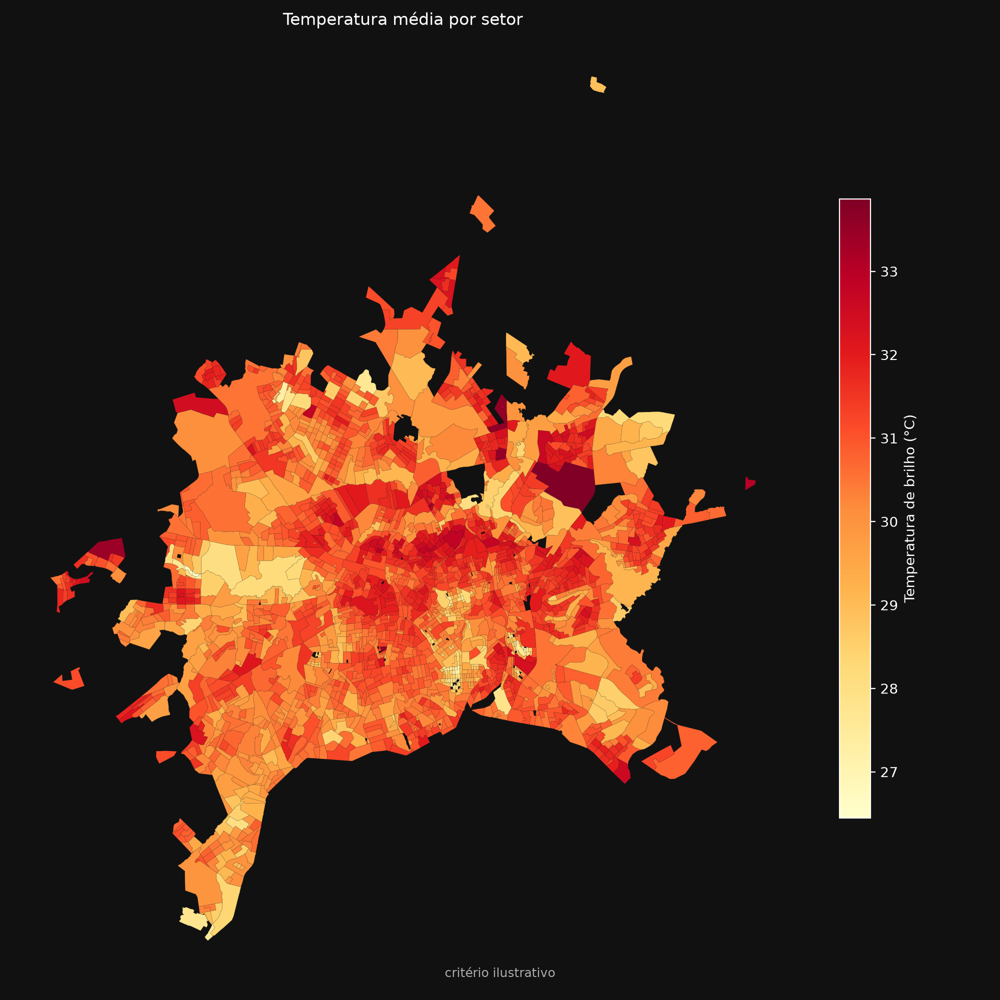
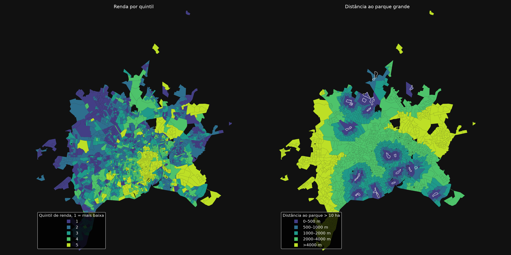
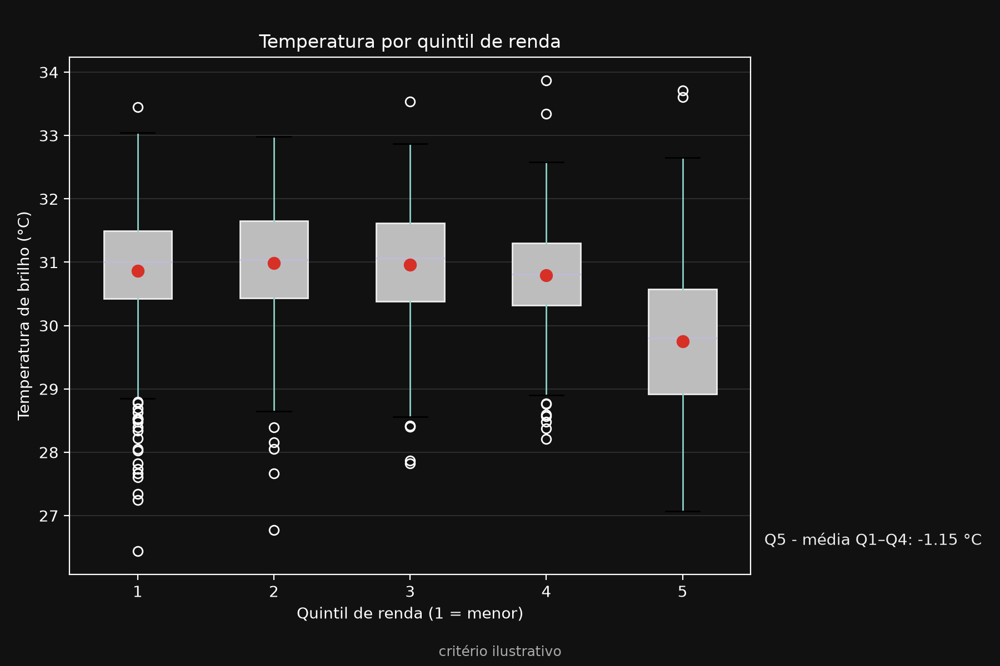
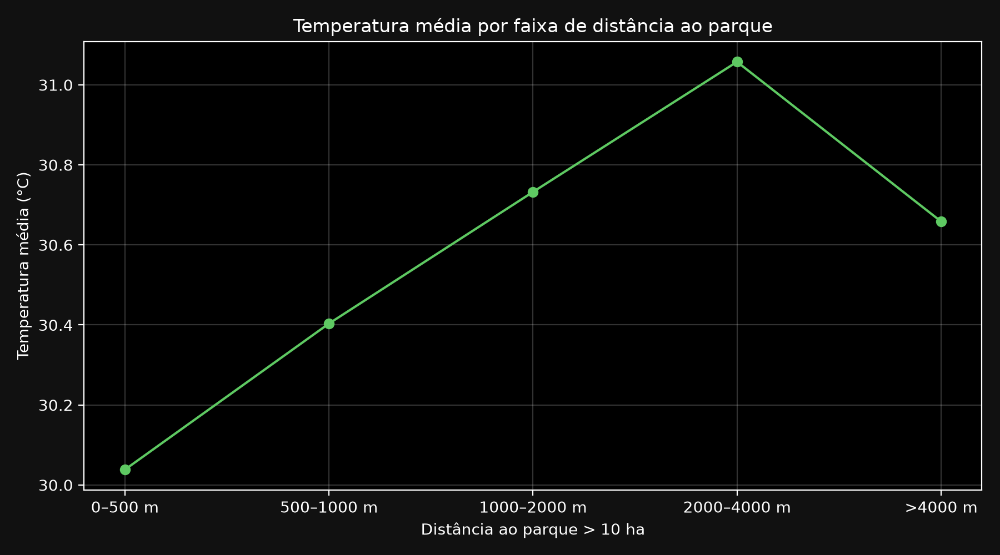
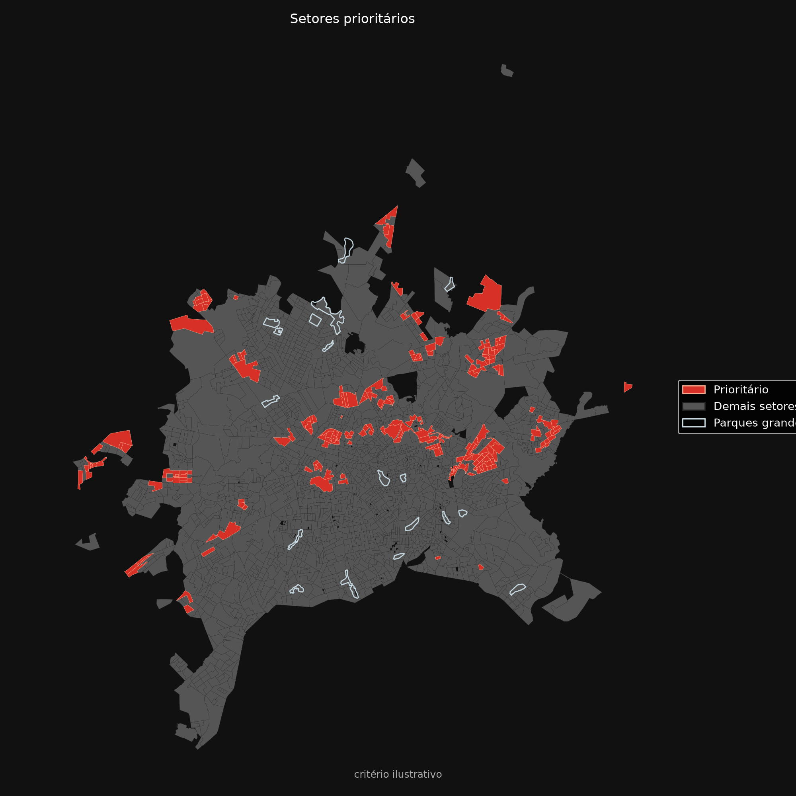

```{ojs}
//| output: false
// ---------- bibliotecas (CDN, versão fixa) e dados ----------
d3 = import("https://cdn.jsdelivr.net/npm/d3@7.9.0/+esm")
Plot = import("https://cdn.jsdelivr.net/npm/@observablehq/plot@0.6.16/+esm")
mapaLib = import(new URL("assets/mapa.js", document.baseURI).href)
setoresGeo = FileAttachment("data/sectors.geojson").json()
parquesGeo = FileAttachment("data/parks.geojson").json()
setores = setoresGeo.features.map((f) => f.properties)

// ---------- formatação em pt-BR ----------
// sinal de menos tipográfico (−) no lugar do hífen
fmt = (x, c = 2) => x.toLocaleString("pt-BR", { minimumFractionDigits: c, maximumFractionDigits: c }).replace("-", "−")
fmtInt = (x) => x.toLocaleString("pt-BR")
fmtRenda = (x) => "R$ " + x.toLocaleString("pt-BR", { maximumFractionDigits: 1 })
DESTAQUE = "#fdae61"
TINTA = "#d9d4ca"
APAGADO = "#8d8a84"

// ---------- estatísticas por quintil (d3.quantile = mesmo método do pandas) ----------
estatQuintis = d3.range(1, 6).map((q) => {
  const g = setores.filter((d) => d.quintil === q);
  const t = g.map((d) => d.temperatura);
  return {
    quintil: q, rotulo: `Q${q}`, n: g.length,
    media: d3.mean(t), mediana: d3.median(t),
    q1: d3.quantile(t, 0.25), q3: d3.quantile(t, 0.75),
    distMedia: d3.mean(g, (d) => d.dist_park_m) / 1000,
    distMediana: d3.median(g, (d) => d.dist_park_m) / 1000,
    rendaMin: d3.min(g, (d) => d.income_median), rendaMax: d3.max(g, (d) => d.income_median),
    arvore: d3.mean(g, (d) => d.pct_tree), construido: d3.mean(g, (d) => d.pct_built), ndvi: d3.mean(g, (d) => d.ndvi_mean)
  };
})
Q1 = estatQuintis[0]
Q5 = estatQuintis[4]
mediaQ1aQ4 = d3.mean(estatQuintis.slice(0, 4), (d) => d.media)          // média das 4 médias de grupo
mediaQ1aQ4Setores = d3.mean(setores.filter((d) => d.quintil < 5), (d) => d.temperatura)
difQ5 = Q5.media - mediaQ1aQ4
faixasRenda = estatQuintis.map((d) => ({ quintil: d.quintil, min: d.rendaMin, max: d.rendaMax }))
paradasTemp = [0.05, 0.25, 0.5, 0.75, 0.95].map((p) => d3.quantile(setores, p, (d) => d.temperatura))

// ---------- correlação de Spearman (renda × temperatura), com postos médios nos empates ----------
postos = (v) => {
  const ordem = d3.range(v.length).sort((a, b) => v[a] - v[b]);
  const r = new Array(v.length);
  for (let i = 0; i < ordem.length; ) {
    let j = i;
    while (j + 1 < ordem.length && v[ordem[j + 1]] === v[ordem[i]]) j++;
    for (let k = i; k <= j; k++) r[ordem[k]] = (i + j) / 2 + 1;
    i = j + 1;
  }
  return r;
}
spearman = {
  const a = postos(setores.map((d) => d.income_median));
  const b = postos(setores.map((d) => d.temperatura));
  const ma = d3.mean(a), mb = d3.mean(b);
  return d3.sum(a, (x, i) => (x - ma) * (b[i] - mb)) /
    Math.sqrt(d3.sum(a, (x) => (x - ma) ** 2) * d3.sum(b, (x) => (x - mb) ** 2));
}

// ---------- critério de prioridade do estudo ----------
limiarP75 = d3.quantile(setores, 0.75, (d) => d.temperatura)
ehPrioritario = (d, quintis, limiar, distancia) =>
  quintis.includes(d.quintil) && d.temperatura > limiar && d.dist_park_m > distancia
idsPrioritarios = new Set(setores.filter((d) => ehPrioritario(d, [1, 2], limiarP75, 2000)).map((d) => d.sector_id))
nPrio = idsPrioritarios.size
pctPrio = (100 * nPrio) / setores.length
ESPERADO_PRIO = 225   // contagem da v1 e do notebook 06, usada só para conferência

// ---------- faixas de distância ao parque ----------
faixas = [
  { rotulo: "< 0,5 km", min: 0, max: 500 },
  { rotulo: "0,5–1 km", min: 500, max: 1000 },
  { rotulo: "1–2 km", min: 1000, max: 2000 },
  { rotulo: "2–4 km", min: 2000, max: 4000 },
  { rotulo: "> 4 km", min: 4000, max: Infinity }
]
estatFaixas = faixas.map((f) => {
  const g = setores.filter((d) => d.dist_park_m >= f.min && d.dist_park_m < f.max);
  return { ...f, n: g.length, media: d3.mean(g, (d) => d.temperatura), mediana: d3.median(g, (d) => d.temperatura) };
})
difPerto2a4 = estatFaixas[3].media - estatFaixas[0].media

// ---------- largura das áreas largas (.column-page), reativa ao redimensionar ----------
larguraLarga = Generators.observe((notificar) => {
  const alvo = document.getElementById("medida-pagina");
  const obs = new ResizeObserver(() => notificar(Math.max(320, alvo.clientWidth)));
  obs.observe(alvo);
  notificar(Math.max(320, alvo.clientWidth));
  return () => obs.disconnect();
})
```

<div id="medida-pagina" class="column-page" aria-hidden="true"></div>

::: {.column-margin}
**Versão 2, interativa.** A versão anterior, estática, continua em [../index.html](../index.html).
:::

::: {.lede}
Goiânia é conhecida como cidade verde. Mas o frescor e o verde chegam a todos os bairros do mesmo jeito?

Para responder, cruzamos imagens de satélite com o Censo 2022 em **${fmtInt(setores.length)} setores urbanos**. O resultado, em três pontos:
:::

1. **Só o grupo mais rico vive em um bairro mais fresco**, cerca de **${fmt(-difQ5)} °C** abaixo dos outros quatro grupos de renda, que são muito parecidos entre si.
2. **O acesso a parques grandes é desigual:** a distância mediana até um parque grande é de ${fmt(Q5.distMediana, 1)} km para os mais ricos e ${fmt(Q1.distMediana, 1)} km para os mais pobres.
3. **${fmtInt(nPrio)} setores** reúnem renda baixa, calor alto e distância de qualquer parque grande: são os candidatos a receber ação primeiro.

::: {.column-margin}
Todos os números desta página são calculados no navegador, a partir da tabela de setores, no momento em que ela abre.
:::

{.column-page}

## Por que olhar para o calor?

Calor urbano não se distribui por acaso. Superfícies construídas e solo exposto esquentam mais do que áreas com árvores e água, e o efeito se acumula em quem vive e trabalha nessas áreas. Em uma cidade grande, isso é uma questão de **justiça ambiental**: quem sofre mais com o calor é, muitas vezes, quem tem menos recursos para se proteger dele.

<!-- Se confirmar os trechos: acrescentar aqui a referência a Sousa e Ferreira (2012) sobre bairros periféricos e a ilha de calor em Goiânia. Só cite o que o texto realmente afirma. -->

::: {.pull}
Na Goiânia de hoje, o frescor está igualmente disponível?
:::

Essa é a pergunta do trabalho. Não buscamos provar que a renda *causa* o calor. Buscamos medir se existe uma desigualdade de exposição, e onde ela é mais forte.

## Os dados

| O que | De onde | Como entrou |
|---|---|---|
| Temperatura da superfície | Satélites Landsat 8 e 9 (banda térmica), ago–set 2026 | Média por setor |
| Renda | Censo 2022, IBGE (renda do responsável pelo domicílio) | Mediana por setor |
| Cobertura do solo | ESA WorldCover 2021 | % de árvores, construído, grama e solo exposto |
| Altitude | SRTM | Média por setor |
| Parques | OpenStreetMap, áreas acima de 10 ha (${parquesGeo.features.length} polígonos) | Distância do centro do setor ao parque mais próximo |
| Unidade de análise | Setores censitários urbanos (IBGE) | ${fmtInt(setores.length)} setores após aplicar a máscara urbana |

::: {.column-margin}
**Setor censitário:** a menor área para a qual o IBGE divulga dados de renda. Em Goiânia, cada setor tem em geral algumas centenas de domicílios.
:::

::: {.callout-note collapse="true"}
## Como o satélite mede a temperatura
Usamos a **temperatura de brilho** da banda térmica do Landsat: a temperatura da *superfície* (telhado, asfalto, solo, copa de árvore), e não do ar que respiramos. Ela é útil para comparar áreas da mesma cidade, mas não equivale ao termômetro do dia a dia. Tentamos primeiro o produto de temperatura de superfície corrigido (nível 2), mas ele falhou em 513 setores, então usamos o produto de nível 1, que cobre todos. A janela é de agosto e setembro de 2026, no período seco do Cerrado.
:::

::: {.callout-note collapse="true"}
## Colunas da tabela usada nesta página
`sector_id` (código IBGE do setor), `income_median` (renda mediana do responsável, R$), `quintil` (1 a 5), `temperatura` (°C, média do setor), `resid` (resíduo do modelo de regressão), `dist_park_m` (distância ao parque grande mais próximo, m), `pct_built` e `pct_tree` (% de área construída e de árvores), `ndvi_mean` (índice de vegetação médio). A marcação de setor prioritário não vem pronta: é calculada aqui, com o critério descrito em "Onde agir primeiro".
:::

## O que fizemos, passo a passo

1. **Recortamos a área urbana.** Aplicamos uma máscara para tirar zonas rurais e vazios que distorcem a média de um setor.
2. **Calculamos a temperatura média de cada setor** a partir das imagens de satélite.
3. **Juntamos renda, cobertura do solo, altitude e distância a parques** na mesma tabela, uma linha por setor.
4. **Dividimos os setores em cinco grupos de renda (quintis)**, do mais pobre (Q1) ao mais rico (Q5).
5. **Comparamos a temperatura entre os grupos** e testamos se a diferença se mantém depois de controlar por vegetação, área construída, altitude e parques.
6. **Marcamos os setores prioritários** com um critério explícito e testamos a sensibilidade a ele.

## Só os mais ricos têm um bairro mais fresco

::: {.pull}
Entre cinco grupos de renda, só o mais rico escapa do calor.
:::

Os grupos Q1 a Q4 têm temperatura muito parecida: as medianas ficam entre ${fmt(d3.min(estatQuintis.slice(0, 4), (d) => d.mediana), 1)} e ${fmt(d3.max(estatQuintis.slice(0, 4), (d) => d.mediana), 1)} °C. Só o Q5 se separa, [${fmt(-difQ5)} °C]{.big} abaixo da média dos outros quatro.

```{ojs}
//| column: page
viewof quintilClicado = {
  // dispersão vertical fixa (semente) para os pontos não se sobreporem
  const aleatorio = d3.randomLcg(7);
  const desvio = new Map(setores.map((d) => [d.sector_id, (aleatorio() - 0.5) * 0.56]));
  const cor = (q) => (q === 5 ? DESTAQUE : APAGADO);
  const grafico = Plot.plot({
    width: larguraLarga,
    height: 380,
    marginLeft: 48,
    marginBottom: 44,
    style: { background: "transparent", color: TINTA, fontFamily: "system-ui, sans-serif", fontSize: "12px" },
    x: { label: "Temperatura de superfície (°C) →", grid: true, tickFormat: (d) => fmt(d, 0) },
    y: { domain: [5.6, 0.4], ticks: [1, 2, 3, 4, 5], tickFormat: (d) => `Q${d}`, label: null, tickSize: 0 },
    marks: [
      Plot.dot(setores, { x: "temperatura", y: (d) => d.quintil + desvio.get(d.sector_id), r: 1.6,
        fill: (d) => cor(d.quintil), fillOpacity: 0.32 }),
      Plot.ruleX([mediaQ1aQ4], { y1: 0.5, y2: 4.5, stroke: APAGADO, strokeDasharray: "3,3" }),
      Plot.text([mediaQ1aQ4], { x: (d) => d, y: 0.45, text: () => "média Q1–Q4", fill: APAGADO, dy: 0, textAnchor: "start", dx: 4 }),
      Plot.rect(estatQuintis, { x1: "q1", x2: "q3", y1: (d) => d.quintil - 0.32, y2: (d) => d.quintil + 0.32,
        fill: "none", stroke: (d) => (d.quintil === 5 ? DESTAQUE : TINTA), strokeWidth: 1.3 }),
      Plot.ruleX(estatQuintis, { x: "mediana", y1: (d) => d.quintil - 0.32, y2: (d) => d.quintil + 0.32,
        stroke: (d) => (d.quintil === 5 ? DESTAQUE : TINTA), strokeWidth: 2.5 }),
      Plot.dot(estatQuintis, { x: "media", y: "quintil", r: 4, fill: "#0e0e0e",
        stroke: (d) => (d.quintil === 5 ? DESTAQUE : TINTA), strokeWidth: 1.5 }),
      Plot.tip(estatQuintis, Plot.pointerY({
        x: "q3", y: "quintil", anchor: "left", fill: "#151515", stroke: "#444",
        title: (d) => [
          `Q${d.quintil} · ${fmtInt(d.n)} setores`,
          `renda mediana ${fmtRenda(d.rendaMin)} a ${fmtRenda(d.rendaMax)}`,
          `média ${fmt(d.media)} °C · mediana ${fmt(d.mediana)} °C`,
          `quartis ${fmt(d.q1)} a ${fmt(d.q3)} °C`,
          "clique para destacar no mapa"
        ].join("\n")
      }))
    ]
  });
  // clique: escolhe (ou desfaz) o quintil sob o ponteiro e avisa o mapa
  const caixa = html`<div class="grafico-quintis">${grafico}</div>`;
  caixa.value = null;
  grafico.addEventListener("input", (e) => e.stopPropagation());
  grafico.addEventListener("click", () => {
    const d = grafico.value;
    caixa.value = d && caixa.value !== d.quintil ? d.quintil : null;
    caixa.dispatchEvent(new Event("input", { bubbles: true }));
  });
  return caixa;
}
```

```{ojs}
//| column: page
html`<p class="legenda-grafico">Cada ponto é um setor. A caixa cobre os 50% do meio, o traço grosso é a mediana e o círculo é a média; a linha tracejada é a média dos grupos Q1 a Q4. Passe o mouse sobre um grupo para ver os números; clique para marcar os setores dele no <a href="#explore-o-mapa">mapa</a>${quintilClicado ? html` (agora: <strong>Q${quintilClicado}</strong> destacado)` : ""}.</p>`
```

::: {.column-margin}
**Como ler o gráfico:** cada faixa horizontal é um grupo de renda. Q1 reúne os setores de renda mais baixa e Q5 os de renda mais alta.
:::

Isso quer dizer que **não existe uma escada** em que cada aumento de renda traz um pouco de frescor. A vantagem está concentrada no topo.

::: {.callout-note collapse="true"}
## Detalhe técnico: quintis e correlação
Os quintis são relativos: dividem os setores em cinco grupos de tamanho parecido pela renda mediana. Como muitos setores têm a mesma renda, os grupos não ficam exatamente iguais (de ${fmtInt(d3.min(estatQuintis, (d) => d.n))} a ${fmtInt(d3.max(estatQuintis, (d) => d.n))} setores). A correlação de Spearman entre renda e temperatura, calculada aqui, é de ${fmt(spearman)}: uma associação moderada.

A diferença de ${fmt(difQ5)} °C compara a média do Q5 com a média das quatro médias de grupo (Q1 a Q4). Se, em vez disso, juntarmos todos os setores de Q1 a Q4 numa média só, a diferença é de ${fmt(Q5.media - mediaQ1aQ4Setores)} °C.
:::

## Não é só falta de árvore

::: {.pull}
A explicação mais óbvia, "bairro pobre tem menos árvore", não se sustenta na média.
:::

Nossa hipótese inicial era que os bairros de renda baixa teriam menos vegetação e mais área construída, e por isso seriam mais quentes. Os dados **não confirmaram isso na média**: o grupo mais pobre tem até mais árvores e menos área construída do que os grupos intermediários.

```{ojs}
html`<table class="tabela-numeros">
  <thead><tr><th>Grupo</th><th>Árvores (%)</th><th>Construído (%)</th><th>NDVI médio</th><th>Temperatura média</th></tr></thead>
  <tbody>${estatQuintis.map((d) => html`<tr class=${d.quintil === 5 ? "linha-destaque" : ""}>
    <td>Q${d.quintil}</td><td>${fmt(d.arvore, 1)}</td><td>${fmt(d.construido, 1)}</td><td>${fmt(d.ndvi)}</td><td>${fmt(d.media)} °C</td></tr>`)}
  </tbody></table>
  <p class="legenda-grafico">Médias por grupo de renda, calculadas a partir da tabela de setores.</p>`
```

Testamos também se o solo exposto e a grama seca explicariam a diferença, e essa explicação também não se sustentou. A vantagem do grupo mais rico **continua** depois de levar em conta vegetação, área construída, solo, altitude e distância a parques.

O que isso sugere, sem provar: a composição do solo medida em 10 metros não captura tudo. Telhados, materiais, verticalização e a forma da cidade também importam.

::: {.callout-note collapse="true"}
## Detalhe técnico: regressão e limites
Estimamos um modelo de regressão (OLS) com a temperatura como resposta e renda padronizada, cobertura do solo e altitude como controles. O coeficiente da renda padronizada fica entre −0,43 e −0,48 °C por desvio-padrão, dependendo dos controles. A colinearidade é baixa (VIF = 3,5). Os resíduos têm forte autocorrelação espacial (Moran's I = 0,68), então os erros-padrão são otimistas e **não usamos valores de p**.

Esses valores vêm da análise dos notebooks e estão reproduzidos aqui como na versão 1; não são recalculados na página.
:::

## Parques: perto é mais fresco, mas nem todos estão perto

::: {.pull}
${fmt(Q5.distMediana, 1)} km de um parque para os mais ricos. ${fmt(Q1.distMediana, 1)} km para os mais pobres.
:::

Usamos os ${parquesGeo.features.length} parques acima de 10 hectares. Os setores mais próximos tendem a ser mais frescos, com uma diferença de cerca de **${fmt(difPerto2a4, 1)} °C** entre os setores a menos de 500 m e os que ficam entre 2 e 4 km. Essa relação não continua além de cerca de 4 km.

::: {.column-margin}
Os valores de distância acima são **medianas**. As médias são maiores, puxadas por setores muito distantes: ${fmt(Q5.distMedia, 2)} km no Q5 e ${fmt(Q1.distMedia, 2)} km no Q1. A versão 1 apresentou as medianas com a palavra "média".
:::

```{ojs}
//| column: page
viewof faixasSel = Inputs.checkbox(faixas.map((f) => f.rotulo), {
  label: "Faixas de distância",
  value: faixas.map((f) => f.rotulo)
})
```

```{ojs}
//| column: page
{
  const ativa = new Set(faixasSel);
  const faixaDe = (m) => faixas.find((f) => m >= f.min && m < f.max).rotulo;
  const maxKm = d3.max(setores, (d) => d.dist_park_m) / 1000;
  const selecionados = estatFaixas.filter((f) => ativa.has(f.rotulo));
  const grafico = Plot.plot({
    width: larguraLarga,
    height: 420,
    marginLeft: 48,
    marginBottom: 44,
    style: { background: "transparent", color: TINTA, fontFamily: "system-ui, sans-serif", fontSize: "12px" },
    x: { label: "Distância ao parque grande mais próximo (km) →", domain: [0, Math.ceil(maxKm)], grid: true },
    y: { label: "↑ Temperatura (°C)", grid: true, tickFormat: (d) => fmt(d, 0) },
    marks: [
      Plot.dot(setores, { x: (d) => d.dist_park_m / 1000, y: "temperatura", r: 1.8,
        fill: (d) => (ativa.has(faixaDe(d.dist_park_m)) ? TINTA : "#3a3a3a"),
        fillOpacity: (d) => (ativa.has(faixaDe(d.dist_park_m)) ? 0.45 : 0.25) }),
      Plot.ruleX([0.5, 1, 2, 4], { stroke: "#555", strokeDasharray: "2,3" }),
      Plot.ruleY(selecionados, { y: "media", x1: (d) => d.min / 1000, x2: (d) => Math.min(d.max / 1000, maxKm),
        stroke: DESTAQUE, strokeWidth: 3 }),
      Plot.tip(setores, Plot.pointer({
        x: (d) => d.dist_park_m / 1000, y: "temperatura", fill: "#151515", stroke: "#444",
        filter: (d) => ativa.has(faixaDe(d.dist_park_m)),
        title: (d) => [
          `setor ${d.sector_id}`,
          `${fmt(d.dist_park_m / 1000)} km do parque · ${fmt(d.temperatura)} °C`,
          `Q${d.quintil} · renda mediana ${fmtRenda(d.income_median)}`
        ].join("\n")
      }))
    ]
  });
  const tabela = html`<table class="tabela-numeros">
    <thead><tr><th>Faixa</th><th>Setores</th><th>Temperatura média</th><th>Mediana</th></tr></thead>
    <tbody>${selecionados.map((f) => html`<tr><td>${f.rotulo}</td><td>${fmtInt(f.n)}</td><td>${fmt(f.media)} °C</td><td>${fmt(f.mediana)} °C</td></tr>`)}</tbody>
  </table>`;
  return html`<div>${grafico}
    <p class="legenda-grafico">Cada ponto é um setor. Os traços na cor de destaque são a temperatura média de cada faixa selecionada. Desmarque faixas para compará-las; passe o mouse sobre um ponto para ver o setor.</p>
    ${tabela}</div>`;
}
```

::: {.column-margin}
A versão 1 diz que a associação se mantém ao excluir os setores que contêm um parque. A tabela usada aqui não tem essa marcação, por isso esse filtro não aparece no gráfico.
:::

Como os parques estão mais perto dos bairros ricos, o benefício de frescor também se distribui de forma desigual.

{.column-page}

Não afirmamos que o parque *causa* o frescor: setores perto de parques também podem ter outras características em comum. A associação é consistente e se mantém ao excluirmos os setores que contêm um parque, mas é uma associação.

## Onde agir primeiro

Para transformar o diagnóstico em prioridade, marcamos [${fmtInt(nPrio)}]{.big} setores (${fmt(pctPrio)}% do total) que atendem a **três condições ao mesmo tempo**:

- renda baixa (grupos Q1 ou Q2),
- temperatura acima do percentil 75 de toda a cidade (${fmt(limiarP75)} °C),
- mais de 2 km de distância de um parque grande.

```{ojs}
nPrio === ESPERADO_PRIO
  ? html``
  : html`<p class="aviso">Atenção: o critério deu ${nPrio} setores, e não ${ESPERADO_PRIO} como na versão 1. Confira os dados em <code>site_v2/data/</code>.</p>`
```

Esse critério é uma **escolha explícita**, feita para orientar onde olhar primeiro, e não um diagnóstico definitivo. No simulador abaixo, você pode mudar cada uma das três condições e ver como o conjunto muda. Ao abrir, ele reproduz o critério do estudo.

```{ojs}
//| column: page
viewof simQuintis = Inputs.checkbox([1, 2, 3, 4, 5], { label: "Grupos de renda incluídos", value: [1, 2], format: (q) => `Q${q}` })
viewof simPercentil = Inputs.range([50, 95], { label: "Temperatura acima do percentil", step: 1, value: 75 })
viewof simDistancia = Inputs.range([0, 5000], { label: "Distância mínima a parque grande (m)", step: 100, value: 2000 })
viewof simReiniciar = Inputs.button("Voltar ao critério do estudo", {
  reduce: () => {
    const definir = (v, valor) => { v.value = valor; v.dispatchEvent(new Event("input", { bubbles: true })); };
    definir(viewof simQuintis, [1, 2]);
    definir(viewof simPercentil, 75);
    definir(viewof simDistancia, 2000);
  }
})
```

```{ojs}
//| output: false
simLimiar = d3.quantile(setores, simPercentil / 100, (d) => d.temperatura)
simIds = new Set(setores.filter((d) => ehPrioritario(d, simQuintis, simLimiar, simDistancia)).map((d) => d.sector_id))
simComuns = [...simIds].filter((id) => idsPrioritarios.has(id)).length
```

```{ojs}
//| column: page
html`<p class="contador" aria-live="polite"><span class="big">${fmtInt(simIds.size)}</span> setores
  (${fmt((100 * simIds.size) / setores.length)}% do total) · limiar de temperatura ${fmt(simLimiar)} °C ·
  ${fmtInt(simComuns)} em comum com o critério do estudo, ${fmtInt(simIds.size - simComuns)} novos,
  ${fmtInt(nPrio - simComuns)} saíram</p>`
```

<div id="mapa-simulador" class="mapa column-page"></div>

```{ojs}
//| output: false
mapaSimulador = (await mapaLib).criarMapa(document.getElementById("mapa-simulador"), {
  setores: setoresGeo, parques: parquesGeo, camada: "simulacao", paradasTemp, faixasRenda, idsPrioritarios
})
atualizaSimulador = mapaSimulador.definirConjunto("sim", simIds)
```

::: {.column-margin}
**Como usar o simulador:** marque ou desmarque grupos de renda, mova os controles de temperatura e distância e veja o mapa e a contagem mudarem. As linhas tracejadas mostram setores que estavam no critério do estudo e saíram com a sua escolha.
:::

Ao variar os limites (percentil, distância, grupos de renda), o conjunto muda de tamanho, mas as manchas principais permanecem.

## Explore o mapa

Troque a camada, passe o mouse para ver o valor de cada setor e clique em um setor para ver todos os dados dele. No celular, toque no setor. Para dar zoom, use os botões, Ctrl + rolagem ou dois dedos.

```{ojs}
//| column: page
viewof camada = Inputs.radio(
  new Map([
    ["Temperatura", "temperatura"],
    ["Quintil de renda", "quintil"],
    ["Distância ao parque", "distancia"],
    ["Setores prioritários", "prioridade"]
  ]),
  { value: "temperatura", label: "Camada" }
)
```

<div id="mapa-explorar" class="mapa column-page"></div>

```{ojs}
//| output: false
mapaExplorar = (await mapaLib).criarMapa(document.getElementById("mapa-explorar"), {
  setores: setoresGeo, parques: parquesGeo, camada: "temperatura", paradasTemp, faixasRenda, idsPrioritarios
})
trocaCamada = mapaExplorar.mostrarCamada(camada)
destaqueQuintil = mapaExplorar.destacarQuintil(quintilClicado)
```

```{ojs}
//| column: page
quintilClicado
  ? html`<p class="legenda-grafico">Contorno claro: setores do <strong>Q${quintilClicado}</strong>, escolhidos no gráfico de grupos de renda. Clique de novo no mesmo grupo para limpar.</p>`
  : html``
```

## O que esta análise não diz

| Limite | Por que importa |
|---|---|
| Associação, não causa | Não afirmamos que a renda causa o calor, nem que um parque, por si só, esfria um bairro. |
| Temperatura de superfície | Não é a temperatura do ar nem a sensação térmica. |
| Janela de dois meses | Agosto e setembro de 2026, no período seco. Outras estações podem mostrar outro padrão. |
| Autocorrelação espacial | Setores vizinhos são parecidos, então a precisão estatística é menor do que parece. |
| Datas diferentes | A renda é do Censo 2022 e as imagens são de 2026. |
| Renda só do responsável | O indicador é a renda do responsável pelo domicílio, não de todos os moradores. |
| Média do setor | Um valor por setor esconde diferenças dentro dele, rua a rua. |
| Setores pequenos e especiais | Têm valores menos confiáveis: a temperatura de setores menores que um pixel térmico vem, em parte, dos vizinhos. |
| Critério de prioridade | É uma escolha. Outros limites mudam o conjunto, como mostra o simulador. |

## Glossário

Setor censitário
: A menor área para a qual o IBGE divulga dados de renda do Censo.

Quintil
: Cada um dos cinco grupos em que os setores foram divididos pela renda mediana, do Q1 (renda mais baixa) ao Q5 (mais alta). É uma posição relativa, não uma linha oficial de pobreza.

Temperatura de superfície
: Temperatura do material visto de cima pelo satélite (telhado, asfalto, solo, copa das árvores). Não é a temperatura do ar.

NDVI
: Índice de vegetação calculado com as bandas do vermelho e do infravermelho próximo. Quanto mais alto, mais vegetação verde e ativa.

Mediana
: O valor do meio quando os setores são ordenados. Metade fica abaixo e metade acima; é menos sensível a extremos do que a média.

Percentil
: O percentil 75 da temperatura é o valor abaixo do qual estão 75% dos setores.

Correlação de Spearman
: Mede se duas variáveis sobem ou descem juntas, usando a ordem dos valores. Vai de −1 a 1; valores negativos indicam que, quando uma sobe, a outra tende a descer.

Regressão (OLS)
: Modelo que estima quanto a temperatura muda com a renda quando outras variáveis (vegetação, área construída, altitude) ficam constantes.

Autocorrelação espacial (I de Moran)
: Tendência de setores vizinhos terem valores parecidos. Quando é forte, os testes estatísticos comuns parecem mais precisos do que são.

Parque grande
: Área de parque do OpenStreetMap com mais de 10 hectares.

Justiça ambiental
: Ideia de que os benefícios e os prejuízos ambientais não deveriam se concentrar em grupos sociais específicos.

## Reprodução

O código e os dados processados estão no repositório [github.com/HannahGrecco/goiania-thermal-justice](https://github.com/HannahGrecco/goiania-thermal-justice).

1. **Preparação e análise:** notebooks `01_data_prep` a `06_analysis_clean`, em `notebooks/`. As imagens Landsat são processadas no Google Earth Engine (exige conta). [CONFERIR: ordem exata de execução dos notebooks e dos scripts `step3_4_prep.py`, `step_elev.py` e `step5_priority.py`]
2. **Tabela da web:** `scripts/step3_4_prep.py` grava `outputs/web/sectors.geojson` (uma linha por setor) e `cache/goiania_large_parks.gpkg` (parques).
3. **Esta página:** a tabela de setores é copiada sem alteração para `site_v2/data/`, os parques são convertidos para EPSG:4326, e tudo o mais é calculado no navegador. Para gerar o site: `uv run quarto render site_v2`.

::: {.callout-note collapse="true"}
## Figuras estáticas da versão 1
As versões interativas acima substituem estas figuras. Elas ficam aqui como referência e plano B; clique para ampliar.

{group="v1"}

{group="v1"}

{group="v1"}
:::
